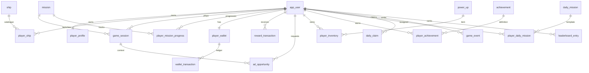

# Database Schema — PostgreSQL (Supabase)

## 1. Purpose and conventions

This is a **proposed relational schema** for the supplied SPACE SHOOTER ODYSSEY feature set. The assignment PDF lists recommended model boundaries but does not prescribe exact SQL columns or DDL. The schema below translates those model boundaries into PostgreSQL tables suitable for Spring Data JPA/Hibernate.

- PostgreSQL is the source of truth; do not persist wallet authority only in browser storage.
- Use UUID primary keys for user-owned/runtime records; use stable text keys for authored catalogue content such as `mission_id`, `ship_id` and `powerup_id`.
- Use `timestamptz` for event times and UTC in storage. Apply one documented server-side timezone/reset policy for daily systems.
- Use `numeric(19,4)` or integer minor units for currency amounts; do not use floating-point for balances.
- Use `bigint` for score/XP counters where appropriate.
- Use optimistic locking (`version`) for frequently updated aggregate rows, plus transactions/row locks for spending.
- Store structured mission/configuration payloads as `jsonb` only where flexible content is valuable; keep query-critical relationships and constraints relational.
- Use Flyway or Liquibase migrations. Production Hibernate setting should validate the schema, not silently recreate it.

## 2. Entity relationship overview

## 3. Core identity and profile tables

### `app_user`

| Column | Type | Rules |
|---|---|---|
| `id` | uuid | PK |
| `email` | varchar(255) | NOT NULL, UNIQUE, normalized |
| `password_hash` | varchar(255) | NOT NULL |
| `display_name` | varchar(40) | NOT NULL |
| `role` | varchar(20) | NOT NULL, `PLAYER` or `ADMIN` |
| `status` | varchar(20) | NOT NULL, e.g. `ACTIVE`, `SUSPENDED` |
| `created_at`, `updated_at` | timestamptz | NOT NULL |

Never store plaintext passwords. Spring Security password encoder generates `password_hash`.

### `player_profile`

| Column | Type | Rules |
|---|---|---|
| `user_id` | uuid | PK and FK → `app_user.id` |
| `player_level` | integer | NOT NULL DEFAULT 1, CHECK >= 1 |
| `xp_total` | bigint | NOT NULL DEFAULT 0, CHECK >= 0 |
| `selected_ship_id` | varchar(64) | FK → `ship.id`, nullable during onboarding |
| `current_sector_id` | varchar(64) | FK → `sector.id` |
| `total_score` | bigint | NOT NULL DEFAULT 0 |
| `best_score` | bigint | NOT NULL DEFAULT 0 |
| `missions_completed` | integer | NOT NULL DEFAULT 0 |
| `current_mission_streak` | integer | NOT NULL DEFAULT 0 |
| `longest_mission_streak` | integer | NOT NULL DEFAULT 0 |
| `last_login_at` | timestamptz | nullable |
| `created_at`, `updated_at` | timestamptz | NOT NULL |
| `version` | bigint | optimistic lock |

### `player_settings`

`user_id` PK/FK, `music_enabled`, `music_volume`, `sfx_enabled`, `sfx_volume`, `master_volume`, `updated_at`. Store volumes as bounded decimal values from 0 to 1. Additional control preferences can be added if implemented.

## 4. Campaign and mission catalogue

### `sector`

`id` varchar(64) PK, `name`, `description`, `sequence_no` UNIQUE, `background_asset`, `unlock_requirements` jsonb, `is_active`, timestamps.

Seed the five sectors: Orion Frontier, Crimson Nebula, Frozen Expanse, Rift Territory and Void Citadel.

### `mission`

| Column | Type | Rules |
|---|---|---|
| `id` | varchar(64) | PK, e.g. `orion-01` |
| `sector_id` | varchar(64) | FK → sector |
| `sequence_no` | integer | NOT NULL |
| `name`, `description` | text | NOT NULL |
| `difficulty` | varchar(20) | NOT NULL |
| `objective_config` | jsonb | NOT NULL |
| `wave_config` | jsonb | NOT NULL |
| `boss_id` | varchar(64) | nullable |
| `reward_config` | jsonb | NOT NULL |
| `star_criteria` | jsonb | NOT NULL |
| `unlock_requirements` | jsonb | NOT NULL DEFAULT `[]` |
| `mission_modifiers` | jsonb | NOT NULL DEFAULT `[]` |
| `is_active` | boolean | NOT NULL DEFAULT true |

Constraint: UNIQUE (`sector_id`, `sequence_no`). Index (`sector_id`, `is_active`, `sequence_no`). Content definitions are server-controlled; clients may cache read-only copies.

### `player_mission_progress`

`id` uuid PK, `user_id` FK, `mission_id` FK, `status` (`LOCKED`, `AVAILABLE`, `COMPLETED`), `best_score`, `best_stars`, `best_duration_ms`, `completed_at`, `attempt_count`, `updated_at`. UNIQUE (`user_id`, `mission_id`); index (`user_id`, `status`).

Replay eligibility and unlock transitions are calculated by backend services.

## 5. Ships and upgrades

### `ship`

`id` varchar(64) PK, `name`, `class_type`, `description`, `art_asset`, `base_stats` jsonb, `unlock_requirements` jsonb, `unlock_cost_credits`, `unlock_cost_energy_cores`, `is_starter`, `is_active`, `created_at`, `updated_at`.

`base_stats` contains the authoritative base weapon damage, firing rate, health, movement speed, shield capacity, special cooldown and projectile attributes.

### `player_ship`

`id` uuid PK, `user_id` FK, `ship_id` FK, `is_selected`, `owned_at`, `upgrade_levels` jsonb, `updated_at`, `version`. UNIQUE (`user_id`, `ship_id`). Add a partial unique index ensuring at most one selected ship per user, or enforce selection in a transactional service and verify with a suitable constraint strategy.

Upgrade levels are bounded by server-side configuration; client-submitted prices or resulting stats are ignored.

## 6. Game sessions and history

### `game_session`

| Column | Type | Rules |
|---|---|---|
| `id` | uuid | PK, externally exposed as session ID |
| `user_id` | uuid | FK → app_user |
| `mission_id` | varchar(64) | FK → mission |
| `selected_ship_id` | varchar(64) | FK → ship |
| `status` | varchar(24) | `CREATED`, `ACTIVE`, `PAUSED`, `FAILED`, `COMPLETED`, `ABANDONED`, `FINALIZED`, `EXPIRED` |
| `started_at`, `ended_at` | timestamptz | |
| `initial_state` | jsonb | server-generated |
| `checkpoint_state` | jsonb | nullable |
| `result_payload` | jsonb | nullable; validated server-side |
| `score` | bigint | NOT NULL DEFAULT 0 |
| `duration_ms` | bigint | nullable |
| `enemies_defeated` | integer | NOT NULL DEFAULT 0 |
| `bosses_defeated` | integer | NOT NULL DEFAULT 0 |
| `damage_taken` | integer | NOT NULL DEFAULT 0 |
| `accuracy` | numeric(6,3) | nullable |
| `stars_awarded` | smallint | nullable, CHECK 0–3 |
| `completion_claimed_at` | timestamptz | nullable |
| `version` | bigint | optimistic lock |

Indexes: (`user_id`, `started_at DESC`), (`mission_id`, `status`), UNIQUE ID. A finalized session cannot be reused for completion or claim.

### `mission_history` (optional projection)

Could be a view over finalized `game_session` rows. Create a separate table only if read/reporting workload justifies a denormalized projection. Do not maintain two conflicting sources of truth.

## 7. Wallet and economy

### `player_wallet`

`user_id` uuid PK/FK, `credits` numeric(19,4) NOT NULL DEFAULT 0 CHECK >= 0, `energy_cores` numeric(19,4) NOT NULL DEFAULT 0 CHECK >= 0, `veloop_reward_coins` numeric(19,4) NOT NULL DEFAULT 0 CHECK >= 0, `updated_at`, `version`.

XP remains in `player_profile`, not a spendable wallet balance. VELoop Reward Coins remain separately governed and should only be updated through platform-eligible verified reward flows.

### `wallet_transaction`

| Column | Type | Rules |
|---|---|---|
| `id` | uuid | PK |
| `user_id` | uuid | FK |
| `currency` | varchar(32) | `CREDITS`, `ENERGY_CORES`, `VELOOP_REWARD_COINS` |
| `transaction_type` | varchar(40) | `CREDIT`, `DEBIT`, `MISSION_REWARD`, `BOSS_REWARD`, `UPGRADE_PURCHASE`, `BOOSTER_PURCHASE`, `DAILY_BONUS`, `AD_REWARD`, `REVERSAL` |
| `amount` | numeric(19,4) | positive magnitude |
| `balance_before`, `balance_after` | numeric(19,4) | NOT NULL |
| `source` | varchar(64) | NOT NULL |
| `reference_id` | varchar(128) | session, event, purchase or opportunity reference |
| `idempotency_key` | varchar(128) | NOT NULL, UNIQUE |
| `status` | varchar(20) | `PENDING`, `COMMITTED`, `REVERSED`, `REJECTED` |
| `created_at` | timestamptz | NOT NULL |

Indexes: (`user_id`, `created_at DESC`), (`user_id`, `currency`, `created_at DESC`), (`source`, `reference_id`). Ledger rows are append-only; corrections use reversal entries rather than edits.

### `economy_config`

`id` uuid PK, `config_key` varchar UNIQUE, `config_value` jsonb, `version_no`, `is_active`, `updated_by` FK app_user, `updated_at`. Admin changes are validated and audited. Separate per-game configuration if multi-game tenancy is introduced.

## 8. Rewards and advertising

### `reward_transaction`

`id` uuid PK, `user_id` FK, `game_session_id` FK nullable, `mission_id` FK nullable, `reward_type`, `currency`, `amount`, `multiplier`, `source`, `ad_provider`, `ad_event_id`, `verification_status`, `idempotency_key` UNIQUE, `created_at`. This records reward decision/verification context and complements the wallet ledger; define one transaction boundary so a granted currency reward and its ledger entry cannot diverge.

### `ad_opportunity`

`id` uuid PK, `user_id` FK, `game_session_id` FK nullable, `mission_id` FK nullable, `placement_type` (`REVIVE`, `DOUBLE_SCORE`, `DOUBLE_CREDITS`, `POWER_UP`, `DAILY_BONUS`), `provider`, `status`, `provider_event_id`, `expires_at`, `requested_at`, `started_at`, `completed_at`, `verified_at`, `granted_at`, `rejection_reason`, `created_at`. Index (`user_id`, `created_at DESC`), (`game_session_id`, `placement_type`), (`status`, `expires_at`). Unique provider event ID when available. Opportunity IDs and provider events must be one-time processed.

### `ad_limit_counter` (recommended)

`id` uuid PK, `user_id` FK, `window_type` (`SESSION`, `HOUR`, `DAY`, `MISSION`), `window_key`, `placement_type`, `count`, `updated_at`; UNIQUE (`user_id`, `window_type`, `window_key`, `placement_type`). Use transactional updates or a robust atomic counter strategy.

## 9. Inventory and power-ups

### `power_up`

`id` varchar(64) PK, `name`, `description`, `effect_type`, `effect_config` jsonb, `duration_ms`, `cooldown_ms`, `max_uses`, `acquisition_method`, `cost_config` jsonb, `unlock_requirements` jsonb, `stacking_rule`, `is_active`.

### `player_inventory`

`id` uuid PK, `user_id` FK, `power_up_id` FK, `quantity` integer NOT NULL CHECK >= 0, `remaining_uses` integer NOT NULL CHECK >= 0, `acquired_at`, `updated_at`, `version`. UNIQUE (`user_id`, `power_up_id`). If items have individual expiry/charges, use child inventory-lot rows instead.

## 10. Engagement

### `daily_mission`

`id` varchar(64) PK, `name`, `description`, `objective_type`, `objective_config` jsonb, `reward_config` jsonb, `is_active`.

### `player_daily_mission`

`id` uuid PK, `user_id` FK, `daily_mission_id` FK, `period_date` date, `progress` integer, `target` integer, `status` (`ACTIVE`, `COMPLETED`, `CLAIMED`, `EXPIRED`), `claimed_at`, `created_at`, `updated_at`. UNIQUE (`user_id`, `daily_mission_id`, `period_date`).

### `daily_claim`

`id` uuid PK, `user_id` FK, `claim_type` (`LOGIN_STREAK`, `DAILY_REWARD`, `SUPPLY_DROP`), `period_key` varchar(32), `streak_day` integer nullable, `reward_payload` jsonb, `idempotency_key` varchar(128) UNIQUE, `claimed_at`. Add UNIQUE (`user_id`, `claim_type`, `period_key`) to block repeated daily claims.

### `achievement`

`id` varchar(64) PK, `name`, `description`, `criteria` jsonb, `reward_config` jsonb, `badge_asset`, `is_active`.

### `player_achievement`

`id` uuid PK, `user_id` FK, `achievement_id` FK, `progress` bigint, `unlocked_at`, `reward_claimed_at`; UNIQUE (`user_id`, `achievement_id`).

### `game_event`

`id` uuid PK, `user_id` FK nullable, `game_session_id` FK nullable, `event_type`, `event_payload` jsonb, `occurred_at`, `received_at`, `source`. Index (`event_type`, `received_at`), (`user_id`, `received_at DESC`), (`game_session_id`, `event_type`). Store only data needed for gameplay validation, analytics and debugging; avoid unnecessary personal data.

### `limited_time_event`

`id` varchar(64) PK, `name`, `description`, `starts_at`, `ends_at`, `eligibility_rules` jsonb, `objective_config` jsonb, `reward_config` jsonb, `is_active`.

### `player_event_progress`

`id` uuid PK, `user_id` FK, `event_id` FK, `progress` bigint, `status`, `claimed_at`, `updated_at`; UNIQUE (`user_id`, `event_id`).

### `leaderboard_entry`

`id` uuid PK, `user_id` FK, `mission_id` FK nullable, `game_session_id` FK, `score` bigint, `metric_type`, `period_key`, `achieved_at`, `validation_status`. UNIQUE (`game_session_id`, `metric_type`, `period_key`); index (`period_key`, `metric_type`, `score DESC`, `achieved_at ASC`). Define tie-break rule, e.g. higher score, then shorter validated duration, then earlier achieved time.

## 11. Suggested indexes and constraints

- Unique normalized email.
- Unique (`sector_id`, `sequence_no`) mission ordering.
- Unique (`user_id`, `mission_id`) progress.
- Unique (`user_id`, `ship_id`) ownership.
- Unique idempotency key for every wallet/reward/claim grant.
- Unique provider event identifier where supplied by ad network.
- Unique (`user_id`, `claim_type`, `period_key`) daily claim.
- Nonnegative CHECK constraints for balances, quantities, XP and counts.
- Foreign keys on all player-owned records.
- Index all common player history lookups by user and descending timestamp.
- Use explicit enum validation in Java and database CHECK constraints where suitable.

## 12. Transaction boundaries

### Ship upgrade

Within one `@Transactional` service method: lock/read wallet and player ship → validate ownership, attribute, max level and server price → verify funds → debit wallet → update upgrade level → insert wallet transaction → commit. Failure rolls back all changes.

### Reward grant

Within one transaction: lock opportunity/session as needed → verify provider event and eligibility → enforce cap/cooldown → insert unique reward transaction → update balance → insert wallet transaction → mark opportunity granted → commit. Unique keys make duplicate callbacks harmless; a duplicate should return the existing result or a controlled conflict, never grant again.

### Mission completion

Validate active session, ownership, mission rules, result bounds and prior claims → compute score/stars/rewards server-side → update progress/profile → insert ledger rows → mark session finalized. Do not accept a browser-supplied reward amount.

## 13. JPA mapping guidance

- Use `@ManyToOne` / `@OneToOne` for stable relational relationships; avoid eager loading large player graphs.
- Use `FetchType.LAZY` for most relationships and explicit DTO projections for APIs.
- Use `@Version` for optimistic locking where concurrent updates can occur.
- Use `@Enumerated(EnumType.STRING)` for persisted enum values.
- Use `BigDecimal` for currency.
- Keep JSONB mapping deliberate and test serialization compatibility.
- Add repository methods for indexed query paths; avoid N+1 by fetch joins/projections.
- Do not expose JPA entities directly as REST response objects.

## 14. Migration and operational policy

- Commit migration scripts and apply them in a controlled deployment step.
- In production set Hibernate DDL mode to `validate` (or equivalent).
- Configure Supabase credentials/SSL using Render environment variables; never commit secrets.
- Test migrations against a clean database and a copy of realistic data.
- Back up production data and define retention for analytics/audit data.
