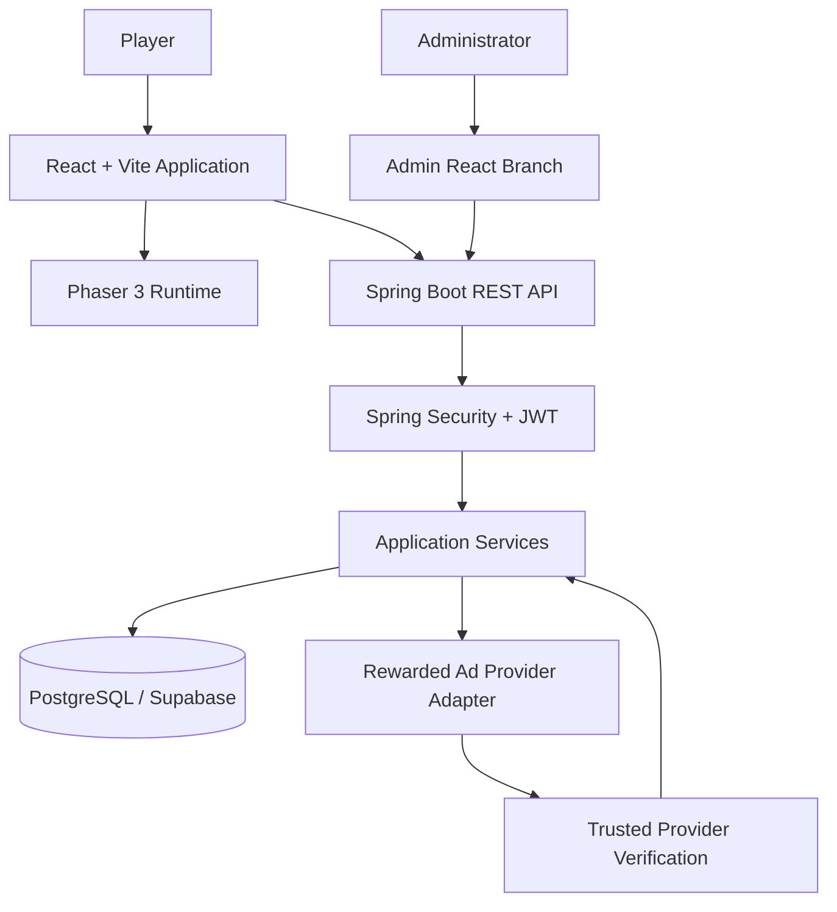
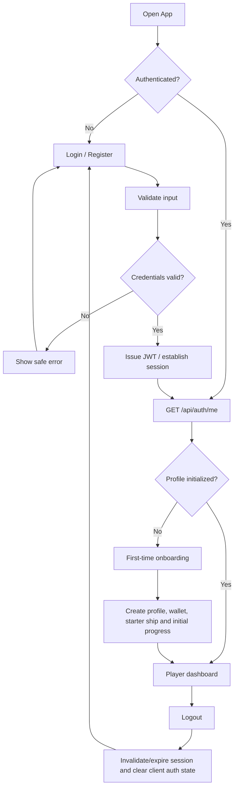
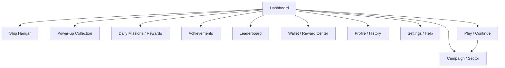
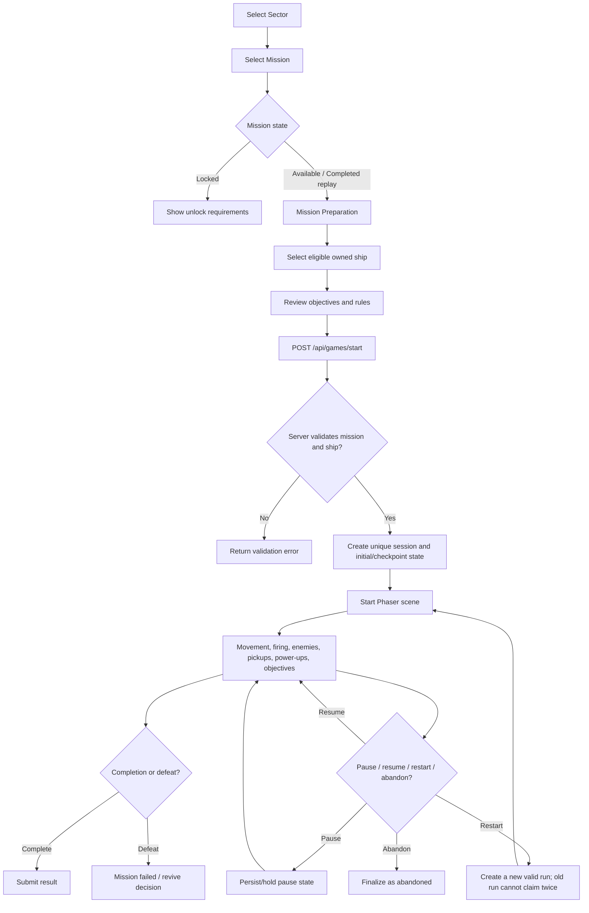
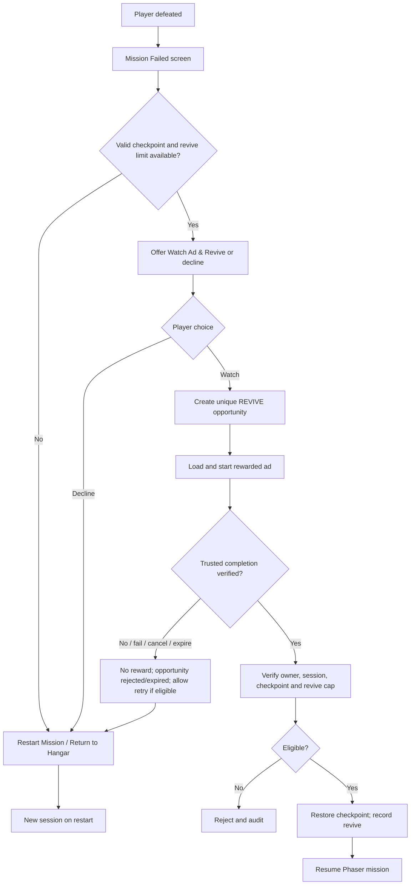
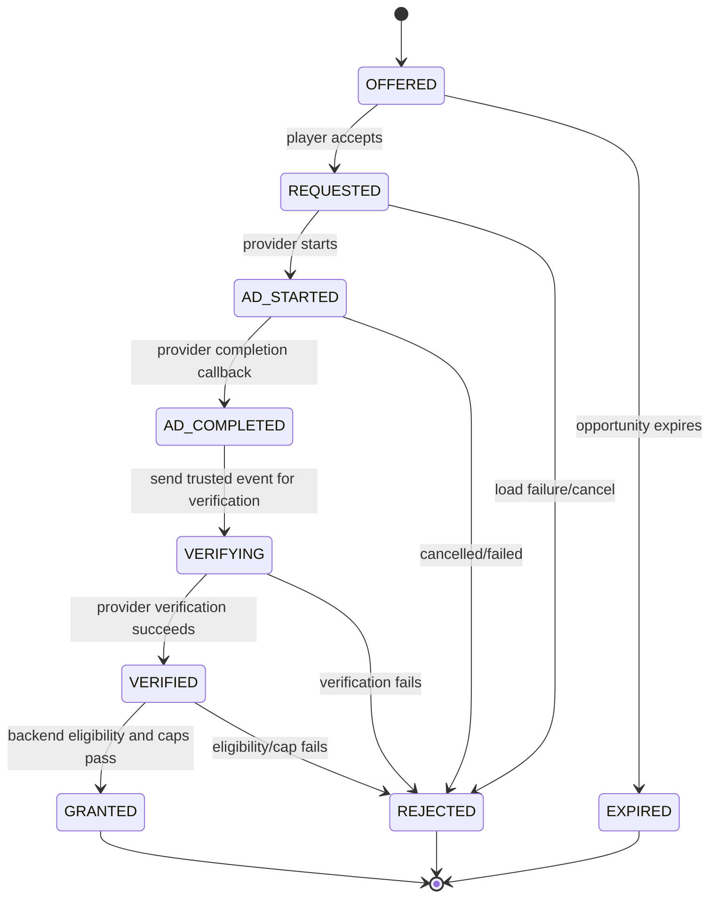
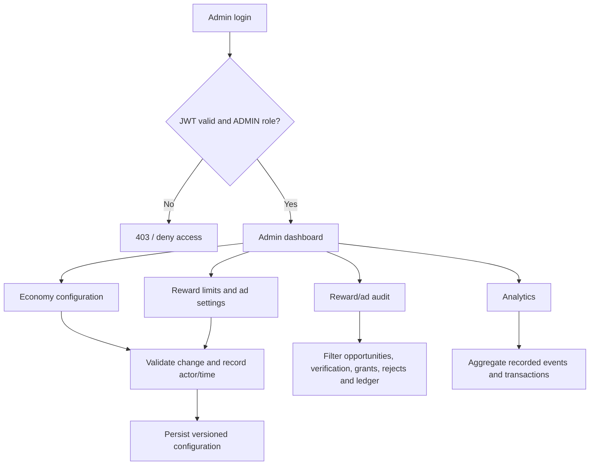

# System Flow — SPACE SHOOTER ODYSSEY

## 1. System context



React owns navigation and application UI. Phaser owns the active game canvas and combat loop. Spring Boot owns identity, persistent progress, unlocks, wallet, rewards, ad opportunities, admin authorization and analytics. PostgreSQL is the durable source of truth.

## 2. Authentication and onboarding



Suggested endpoints:
- `POST /api/auth/register`
- `POST /api/auth/login`
- `POST /api/auth/logout`
- `GET /api/auth/me`

Registration/login validate input and never expose password hashes. Every protected API derives the player identity from the authenticated principal, not a request-supplied user ID. Admin authorization is a separate role check.

## 3. Home dashboard and navigation

Dashboard loads profile, progress, selected ship, wallet, inventory summary, daily missions/rewards, achievements, leaderboard preview and economy configuration. The dashboard's main CTA is Play or Continue Mission. Shortcuts route to campaign, hangar, power-up collection, daily missions, daily rewards, achievements, leaderboard, reward centre and settings.



## 4. Campaign, mission preparation and gameplay



### Campaign content

Sectors: Orion Frontier, Crimson Nebula, Frozen Expanse, Rift Territory, Void Citadel.

Mission states: locked, available, completed and replayable. Initially only the first mission is unlocked. Completing a mission unlocks the next eligible mission according to server rules. At least 50 actual playable, data-driven missions are targeted; mission cards must not all launch one identical hardcoded encounter.

Mission objective types include destroy required enemies, survive a duration, defeat a boss, protect a target, collect mission items, destroy a specified enemy type, complete with limited damage or finish within a time target.

### Phaser gameplay responsibilities

- Player movement and firing; desktop keyboard and mobile touch/drag/virtual joystick.
- Play-area bounds, frame-rate-independent movement and tab visibility handling.
- Player health, shield, damage, hit feedback, temporary invulnerability and defeat.
- Enemy archetypes: Scout Fighter, Interceptor, Armored Cruiser, Long-Range Gunship and Elite Enemy.
- Configured enemy waves, spawn intervals/positions, difficulty and boss conditions.
- Projectile ownership and collision groups; avoid unintended repeated damage per overlap.
- Combat pickups and power-up effects.
- Objective progress, score events, pause/resume and checkpoint handling.

The backend validates the submitted outcome before persistent rewards and leaderboard writes. Browser-side combat is not fully cheat-proof; document this limitation.

## 5. Mission outcome and reward claim

```mermaid
flowchart TD
  COMPLETE[Mission appears complete] --> SUBMIT[POST /api/games/{sessionId}/complete]
  SUBMIT --> VALIDATE[Validate owner, session, mission, duration, score, enemies, boss and objectives]
  VALIDATE --> PASS{Valid and not already finalized?}
  PASS -- No --> REJECT[Reject result / no duplicate reward]
  PASS -- Yes --> CALC[Calculate score, stars, XP and standard rewards on server]
  CALC --> TX[Atomic DB transaction: progress + wallet ledger + reward ledger + final session]
  TX --> RESULT[Show result, stats, stars, standard rewards and unlocks]
  RESULT --> ADOPT{Optional eligible ad bonus?}
  ADOPT -- Decline --> CLAIM[Keep standard reward; continue]
  ADOPT -- Accept --> AD[Create ad opportunity and verify ad completion]
  AD --> GRANT[Grant eligible bonus once]
  GRANT --> CLAIM
  CLAIM --> NEXT[Unlock next mission / return to campaign or hangar]
```

Result screen displays result, score, duration, enemies/bosses defeated, accuracy where measurable, damage taken, power-ups used, Credits, XP, stars and new unlocks. Three-star criteria are configurable and documented; for example, completion, a performance target and a higher target. Standard rewards are not withheld when the player declines an optional ad.

## 6. Mission failure and revive



Example default `MAX_REVIVES_PER_MISSION = 1` is illustrative and configurable. Reopening the dialog cannot reset the limit. A failed ad must not consume an unused revive or grant a reward.

## 7. Ship hangar and upgrade transaction

```mermaid
flowchart TD
  H[Open Hangar] --> LIST[GET ships and owned ship state]
  LIST --> VIEW[Inspect ship attributes / unlock rules]
  VIEW --> SELECT[Select owned ship]
  VIEW --> UPGRADE[Choose attribute upgrade]
  VIEW --> UNLOCK[Unlock eligible ship]
  SELECT --> SELAPI[POST /api/ships/{shipId}/select]
  UPGRADE --> CONFIRM[Show server price and purchase confirmation]
  CONFIRM --> BUY[POST /api/ships/{shipId}/upgrade]
  UNLOCK --> UNLOCKAPI[POST /api/ships/{shipId}/unlock]
  BUY --> TX[Authenticate; load authoritative state; validate level/cost/funds]
  UNLOCKAPI --> TX
  TX --> ATOMIC[Atomic debit + ownership/upgrade update + ledger]
  ATOMIC --> UPDATED[Return updated wallet and ship stats]
  UPDATED --> H
```

Upgrade attributes include weapon damage, firing rate, health, movement speed, shield capacity and special ability cooldown. Server computes prices; database transaction ensures a failed operation cannot leave currency deducted without the upgrade.

## 8. Power-ups and inventory

Required power-ups and expected behavior:

| Power-up | Gameplay effect |
|---|---|
| Shield Pulse | Temporary protection; duration, cooldown, shield visuals |
| Rapid Fire | Temporary firing-rate multiplier; restore base rate on expiry |
| Spread Shot | Multiple projectiles at configured angles and limits |
| Homing Missiles | Limited missiles select and track eligible targets |
| EMP Blast | Radius-based disable/damage with eligible-target rules |
| Repair Drone | Restore bounded health; respect max health |
| Overdrive | Temporary configured stat multipliers and stacking rules |
| Emergency Warp | Safe reposition or brief defensive window |

Flow: load catalogue/inventory → inspect effect → acquire via eligible server-authorized method → backend updates inventory atomically → activate in mission → validate ownership/uses/cooldown → Phaser applies effect → record usage/event → update remaining uses/cooldown. Activation does not itself create a reward claim.

## 9. Wallet, reward centre and engagement

### Wallet

Balances: Credits, Energy Cores, XP and VELoop Reward Coins. XP is not spendable. Show transaction and reward history with source, amount, type, timestamp, status and reference.

Illustrative starting economy values from the assignment:
- Standard mission completion: 100 Credits
- Normal enemy: 2 Credits
- Elite enemy: 10 Credits
- Boss: 250 Credits
- Daily mission: 150 Credits
- Three-star bonus: 50 Credits

These are initial examples, not final commercial rates. Server-controlled configuration determines actual rates.

### Daily missions and login streak

At least three daily mission templates (examples: destroy 30 enemies, complete two missions, defeat one elite, use power-up three times, or complete without losing all health). Track progress and claim once per server-defined period. Login streak records current streak, last eligible claim, claim history, next reward and reset rules. Device clock changes must not enable repeat claims.

### Achievements, mission streaks and supply drops

At least ten achievements with defined criteria and one-time awards. Mission streaks have explicit reset and milestone rules. Supply drops use server-side selection, defined probabilities where random, cooldowns, claim history and repeat limits.

### Limited-time events and leaderboard

At least one functional event with start/end time, eligibility, objective, progress and reward. Backend checks event period. Leaderboard uses validated scores, pagination and documented tie-breaking.

## 10. Rewarded-ad state machine



Placements: `REVIVE`, `DOUBLE_SCORE`, `DOUBLE_CREDITS`, `POWER_UP`, `DAILY_BONUS` (additional mission reward can be a configured subtype/placement). Centralize identifiers. Keep ad state separate from gameplay state.

Provider abstraction should support a real provider adapter and a clearly labelled local simulated adapter. The provider's actual trusted server-side verification mechanism must be used in production. A frontend click, local timer or untrusted callback is not proof of completion.

Example limits in the assignment are tuning examples: maximum five rewarded ads/session, eight/hour, ten/day, 30 seconds minimum interval; maximum one revive, one double-score and one double-Credits claim per eligible mission by default. Actual settings are server-configured. Never show ads during combat or make ads compulsory.

## 11. Profile, history and settings

Profile displays player stats, best scores, mission history, selected/unlocked ships, persistent progress, wallet/inventory and achievement progress. Audio settings independently control background music, sound effects and master volume; persist preferences. Help pages explain gameplay instructions and controls.

## 12. Admin and analytics branch



Audit should cover ad opportunities, completed/failed/rejected ads, revive requests/completions, double-score and double-Credits requests, power-up reward usage, Credits granted/spent and average reward per user.

Metrics include ad completion rate, revive conversion, double-score and double-Credits conversion, average rewards/player, currency sources/sinks, mission duration, missions/session, progression and power-up usage. Calculate from persisted events/ledger data; do not fabricate values.

## 13. REST API catalogue

Routes below follow the assignment's suggested contracts. Path parameter syntax is shown with `{}` for Spring MVC; adapt naming consistently if the implementation differs.

### Authentication
| Method | Route | Purpose | Auth |
|---|---|---|---|
| POST | `/api/auth/register` | Create account/profile | Public |
| POST | `/api/auth/login` | Authenticate and issue token | Public |
| POST | `/api/auth/logout` | End client/server session or revoke refresh token | Auth |
| GET | `/api/auth/me` | Current user/session | Auth |

### Player
| Method | Route | Purpose |
|---|---|---|
| GET | `/api/player/profile` | Player profile and stats |
| GET | `/api/player/progress` | Level, XP, sector and mission progression |
| GET | `/api/player/inventory` | Power-up inventory |
| GET | `/api/player/history` | Mission history |

All require player authentication.

### Missions and sessions
| Method | Route | Purpose |
|---|---|---|
| GET | `/api/missions` | Mission catalogue and player states |
| GET | `/api/missions/{missionId}` | Mission detail |
| POST | `/api/games/start` | Validate and create unique session |
| POST | `/api/games/{sessionId}/complete` | Submit result for validation/finalization |
| POST | `/api/games/{sessionId}/claim` | Claim eligible standard result reward |
| GET | `/api/games/history` | Session history |

### Ships
| Method | Route | Purpose |
|---|---|---|
| GET | `/api/ships` | Catalogue |
| GET | `/api/ships/owned` | Player ownership and upgrades |
| POST | `/api/ships/{shipId}/select` | Select owned ship |
| POST | `/api/ships/{shipId}/upgrade` | Purchase upgrade |
| POST | `/api/ships/{shipId}/unlock` | Unlock eligible ship |

### Power-ups and economy
| Method | Route | Purpose |
|---|---|---|
| GET | `/api/powerups` | Power-up catalogue |
| POST | `/api/powerups/{powerUpId}/acquire` | Acquire eligible item |
| POST | `/api/games/{sessionId}/powerups/use` | Validate and consume/use item |
| GET | `/api/economy/config` | Current public economy settings |
| GET | `/api/wallet/balance` | Authoritative balances |
| GET | `/api/wallet/history` | Wallet ledger |
| GET | `/api/rewards/history` | Reward history |

### Rewarded ads
| Method | Route | Purpose |
|---|---|---|
| POST | `/api/rewards/ad/opportunity` | Create eligible placement opportunity |
| POST | `/api/rewards/ad/verify` | Verify provider event |
| POST | `/api/rewards/ad/claim` | Grant verified eligible reward |
| POST | `/api/games/{sessionId}/revive/request` | Create revive request |
| POST | `/api/games/{sessionId}/revive/verify` | Verify and restore checkpoint |
| POST | `/api/games/{sessionId}/double-score/request` | Request score bonus |
| POST | `/api/games/{sessionId}/double-score/verify` | Verify score bonus |
| POST | `/api/games/{sessionId}/double-credits/request` | Request Credits bonus |
| POST | `/api/games/{sessionId}/double-credits/verify` | Verify Credits bonus |

### Engagement
| Method | Route | Purpose |
|---|---|---|
| GET | `/api/daily-missions` | Current daily tasks |
| POST | `/api/daily-missions/{missionId}/claim` | Claim completed task |
| GET | `/api/achievements` | Achievement progress |
| GET | `/api/leaderboard` | Validated ranking |
| GET | `/api/events` | Active events |
| GET | `/api/events/{eventId}/progress` | Player event progress |

### Admin (proposed extension)
`GET /api/admin/economy/config`, `PUT /api/admin/economy/config/{key}`, `GET /api/admin/rewards/audit`, `GET /api/admin/ads/metrics`, `GET /api/admin/economy/metrics`. Require ADMIN role and audit all changes. These exact admin route names are proposed because the assignment specifies admin capabilities, not exact paths.

For every endpoint document request/response DTOs, auth requirement, validation, error responses and rate limits. Use consistent HTTP statuses (`400` validation, `401` unauthenticated, `403` unauthorized, `404` missing resource, `409` duplicate/state conflict, `429` rate limit, `5xx` server failure).

## 14. Analytics event names

Track events such as:
`game_started`, `mission_started`, `mission_completed`, `mission_failed`, `boss_defeated`, `ship_selected`, `ship_upgraded`, `powerup_used`, `revive_requested`, `revive_completed`, `double_score_requested`, `double_score_completed`, `double_credits_requested`, `double_credits_completed`, `ad_opportunity_created`, `ad_completed`, `reward_granted`, `reward_rejected`, `daily_mission_completed`, `achievement_unlocked`.

Record only information needed for validation, product analytics, economy management and debugging.

## 15. Error and recovery rules

- Network/API failure must not fabricate wallet or progression success.
- Retry-safe operations use idempotency keys; UI disables duplicate submission while pending.
- An expired session cannot claim rewards.
- A failed/cancelled/expired ad grants nothing and does not consume an unused revive.
- A rejected reward is recorded with a reason suitable for audit.
- A purchase failure rolls back wallet and item changes.
- A restart creates a new valid run; a finalized run is immutable for reward claims.
- A player cannot read or mutate another player's data by changing a URL identifier.

## 16. Test and acceptance path

Verify the end-to-end sequence: register/login → dashboard → select ship → start eligible mission → combat controls and collisions → objectives/waves/boss → complete or fail → validated result → wallet/ledger update → optional ad verification → hangar upgrade → mission unlock persists after refresh. Repeat critical claims to confirm duplicate rejection. Test admin role boundaries, mobile touch and desktop keyboard controls. The demo must label simulated ads if no production provider has been configured.
